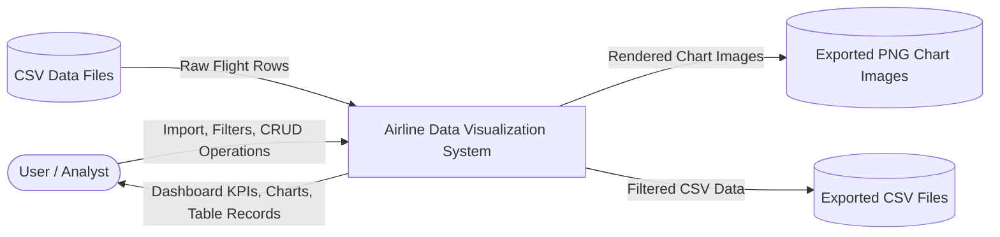
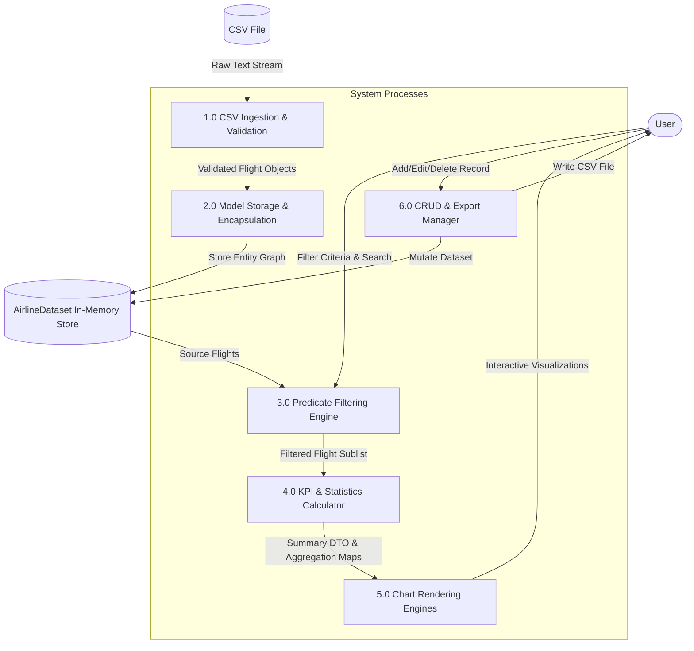

# ✈️ AIRLINE DATA VISUALIZATION SOFTWARE USING OBJECT-ORIENTED PROGRAMMING (OOP) IN JAVA

**A College-Level Academic Project Report & Software Engineering Documentation**

---

## TABLE OF CONTENTS
1. [Project Title](#1-project-title)
2. [Problem Statement](#2-problem-statement)
3. [Objectives](#3-objectives)
4. [Proposed Solution](#4-proposed-solution)
5. [Features & Modules](#5-features--modules)
6. [System Requirements](#6-system-requirements)
7. [Technologies Used](#7-technologies-used)
8. [System Architecture](#8-system-architecture)
9. [UML Class Diagram](#9-uml-class-diagram)
10. [Use Case Diagram](#10-use-case-diagram)
11. [Data Flow Diagrams (DFD Level 0 & Level 1)](#11-data-flow-diagrams)
12. [OOP Concepts Implementation Mapping](#12-oop-concepts-implementation-mapping)
13. [Module Description](#13-module-description)
14. [Algorithms & Operational Workflow](#14-algorithms--operational-workflow)
15. [GUI Layout & Visual Structure](#15-gui-layout--visual-structure)
16. [Advantages of the System](#16-advantages-of-the-system)
17. [Limitations](#17-limitations)
18. [Future Scope](#18-future-scope)
19. [Conclusion](#19-conclusion)

---

## 1. Project Title
**Airline Data Visualization Software Using Object-Oriented Programming (OOP) in Java**

---

## 2. Problem Statement
The aviation industry generates vast volumes of operational data every day, encompassing flight schedules, passenger traffic, punctuality statistics, delays, cancellations, ticket pricing, and route revenues. However, raw tabular logs or flat spreadsheets are notoriously difficult for station managers, flight controllers, and business analysts to interpret quickly. Existing enterprise flight information systems are often prohibitively expensive, overly complex, and lack intuitive visual analytics tailored for academic demonstration and operational research.

There is a critical need for an interactive, modern, lightweight desktop application capable of:
1. Parsing and validating diverse airline datasets from CSV files.
2. Filtering records dynamically based on multiple operational criteria (Carrier, Origin, Destination, Flight Status, Delays).
3. Transforming raw figures into clear visual representations (Bar charts, Donut/Pie charts, Line graphs, and Comparative benchmarks).
4. Demonstrating the core foundational principles of **Object-Oriented Programming (OOP)** in Java in a clean, maintainable, modular architecture.

---

## 3. Objectives
The primary objectives of this software project are:
- **Data Ingestion & Integrity**: Build a resilient CSV data loader capable of parsing flight logs, validating dates/times/numbers, handling malformed rows, and reporting user-friendly errors without crashing.
- **Visual Analytics**: Implement interactive 2D graphics rendering engines for Bar Charts, Donut/Pie Charts, Trend Line Charts, and Multi-Metric Comparison Charts with dynamic auto-scaling and image export.
- **Real-Time Operational Filtering**: Provide multi-criteria query controls that instantly filter datasets and synchronize tables, KPI cards, and charts simultaneously.
- **Dataset Management (CRUD)**: Enable full dataset management (Add new flight, Edit record, Delete flight, Search, and Export filtered records to CSV).
- **Core OOP Demonstration**: Model the domain around fundamental Object-Oriented principles: Classes/Objects, Encapsulation, Inheritance, Polymorphism, Abstraction, Interfaces, Method Overloading/Overriding, and Composition/Aggregation.

---

## 4. Proposed Solution
The proposed solution is a desktop software application built using Java 17 and Swing, adopting the **Model-View-Controller (MVC)** architectural design pattern.

The system decouples data parsing, business processing, state synchronization, and UI rendering:
- **Model**: Encapsulates domain concepts (`Flight`, `CommercialFlight`, `Airline`, `Airport`, `Route`, `AirlineDataset`).
- **Service Layer**: Implements abstract interfaces (`IDataLoader`, `IDataExporter`, `IDataFilter`, `IStatisticsCalculator`) to process flight collections, calculate KPIs, and compute chart aggregations.
- **Controller**: Coordinates actions via the `AppController` and notifies view components via the `IDatasetListener` Observer Pattern.
- **View**: Features a sleek, modern UI comprising an Executive Dashboard, Searchable/Sortable Data Table, Visualizations Hub, Deep Analytics Scorecard, and About Guide.

---

## 5. Features & Modules

### 5.1 Executive Dashboard
- **8 KPI Metric Cards**:
  1. *Total Flights*
  2. *Total Passengers*
  3. *Total Revenue ($)*
  4. *Operating Airlines Count*
  5. *Unique Airports Served*
  6. *Average Flight Delay (minutes)*
  7. *Cancelled Flights Count*
  8. *On-Time Punctuality Percentage (%)*
- **Responsive Mini-Charts**: Real-time Flights by Airline bar chart and Flight Status distribution donut chart.

### 5.2 Dataset Management & CRUD
- **CSV Data Import**: Import local CSV datasets via a standard file chooser.
- **Interactive Data Table**: View all 15 flight attributes in a sortable, scrollable `JTable`.
- **Status Badges**: Color-coded badges for *On-Time* (Emerald), *Delayed* (Amber), and *Cancelled* (Crimson).
- **Record Operations**:
  - *Add Flight Record*: Modal dialog with full field-level validation.
  - *Edit Flight Record*: Modify parameters with automatic revenue recomputation.
  - *Delete Flight Record*: Confirmation prompt and in-memory deletion.
- **Search & Filter**: Real-time multi-attribute text search across Flight ID, Flight No, Airline, Hubs, and Cancellation Reasons.
- **CSV Export**: Export filtered or full dataset to a clean CSV file.

### 5.3 Visualizations Hub
- **Bar Charts**:
  - Flights by Airline
  - Passengers by Airline
  - Revenue by Airline
  - Top 10 Busiest Routes
- **Pie / Donut Charts**:
  - Flight Status Distribution
  - Airline Passenger Market Share
  - Completed vs. Cancelled Flights
- **Trend Line Charts**:
  - Daily Scheduled Flights Volume
  - Daily Revenue Over Time
  - Average Delay Trajectory Over Time
- **Comparison Charts**:
  - Multi-metric Airline Benchmarking (Volume vs Average Delay vs Punctuality Rate)
- **High-Resolution PNG Export**: Save any rendered chart directly to disk.

### 5.4 Operational Analytics & Scorecards
- **Leaderboards**: Full performance scorecards per airline (Flights, Passengers, Revenue, Avg Delay, Punctuality %, Revenue per Passenger).
- **Airport Hub Analytics**: Identification of busiest origin hub, busiest destination airport, most utilized carrier, and max delay recorded.

### 5.5 About & Help Documentation
- Detailed software architecture breakdown, OOP principle mappings, user instructions, and technical specifications.

---

## 6. System Requirements

### Hardware Requirements
- **Processor**: Intel Core i3 / AMD Ryzen 3 or higher (2.0 GHz+).
- **RAM**: Minimum 2 GB RAM (4 GB recommended).
- **Disk Storage**: At least 50 MB free disk space for application files and datasets.
- **Display Resolution**: 1280 x 720 minimum (1920 x 1080 recommended).

### Software Requirements
- **Operating System**: Windows 10/11, macOS, or Linux (Ubuntu, Debian, Fedora).
- **Java Development Kit (JDK)**: OpenJDK 17 or higher (Java SE 17+).
- **Build / Packaging Tool**: Powershell / Batch scripts or Apache Maven 3.6+.

---

## 7. Technologies Used
- **Programming Language**: Java (Version 17 LTS).
- **GUI Framework**: Java Swing (`javax.swing.*`, `java.awt.*`, `java.awt.geom.*`) with 2D vector graphics and anti-aliased geometry rendering.
- **Architecture Pattern**: Model-View-Controller (MVC) + Observer Pattern.
- **Data Format**: Comma-Separated Values (CSV).
- **Build System**: Native `javac` automation scripts (`build.ps1`, `run.ps1`, `build.bat`, `run.bat`) + standard Maven `pom.xml`.

---

## 8. System Architecture

```
+-----------------------------------------------------------------------------------+
|                                PRESENTATION LAYER (VIEW)                          |
|                                                                                   |
|   MainFrame (Sidebar Navigation, Theme Manager, CardLayout Container)             |
|   ├── Top FilterPanel (Airline, Origin, Dest, Status Dropdowns, Search Bar)      |
|   ├── DashboardPanel (8 KPI StatCards, Mini Bar Chart, Donut Status Chart)        |
|   ├── DatasetTablePanel (JTable, TableRowSorter, Add/Edit/Delete Modals)         |
|   ├── VisualizationPanel (Bar, Donut, Line, and Comparison Chart Tabs + PNG Export) |
|   ├── AnalyticsPanel (Airline Scorecards, Operational Leaderboards)               |
|   └── AboutPanel (Architecture & Documentation Guide)                             |
+-----------------------------------------------------------------------------------+
                                          │
                         Dispatches User Events & Filter Changes
                                          ▼
+-----------------------------------------------------------------------------------+
|                                CONTROLLER LAYER                                   |
|                                                                                   |
|   AppController                                                                   |
|   ├── IDatasetListener (Observer Interface notifying Views on state mutations)    |
|   ├── Coordinates Data Loaders, Exporters, Filters, and Analytics Calculators      |
|   └── Manages active working dataset and filtered flight subsets                  |
+-----------------------------------------------------------------------------------+
                                          │
                         Invokes Business Operations & Calculations
                                          ▼
+-----------------------------------------------------------------------------------+
|                             BUSINESS LOGIC & SERVICES                             |
|                                                                                   |
|   IDataLoader <─── CSVDataLoader (Parsing, Tokenization, Validation)             |
|   IDataExporter <── CSVDataExporter (Formatted CSV Generation)                    |
|   IDataFilter <─── DataFilter (Dynamic Predicate Stream Filter)                   |
|   IStatisticsCalculator <── StatisticsCalculator (KPIs, Group-Bys, Aggregations)  |
|   RouteAnalysisService (Airline Punctuality & Revenue Scorecards)                 |
+-----------------------------------------------------------------------------------+
                                          │
                         Instantiates, Encapsulates & Stores
                                          ▼
+-----------------------------------------------------------------------------------+
|                                  MODEL LAYER                                      |
|                                                                                   |
|   BaseEntity (Abstract Superclass)                                                |
|   ├── Flight (Encapsulated Primary Domain Object)                                 |
|   │     └── CommercialFlight (Specialized Subclass: Load Factor, Ancillary Fees)   |
|   ├── Airline (Carrier Metadata)                                                  |
|   ├── Airport (IATA Code, City, Country)                                          |
|   ├── Route (Composition: Origin + Destination + Distance)                        |
|   ├── FlightStatus (Type-Safe Enum: ON_TIME, DELAYED, CANCELLED)                  |
|   ├── AirlineDataset (Aggregate Root managing Flight Collections)                 |
|   └── DatasetSummary (Immutable DTO Snapshot for KPIs)                            |
+-----------------------------------------------------------------------------------+
```

---

## 9. UML Class Diagram

### 9.1 Mermaid Class Diagram

```mermaid
classDiagram
    class BaseEntity {
        <<Abstract>>
        #String id
        #LocalDateTime createdAt
        #LocalDateTime updatedAt
        +getId() String
        +setId(String id) void
        +getDisplayName()* String
        +markUpdated() void
    }

    class Flight {
        -Airline airline
        -String flightNumber
        -Route route
        -LocalDate departureDate
        -LocalTime departureTime
        -LocalTime arrivalTime
        -int durationMinutes
        -int passengerCount
        -double ticketPrice
        -double totalRevenue
        -int delayMinutes
        -FlightStatus status
        -String cancellationReason
        +calculateRevenue() double
        +isOnTime() boolean
        +isDelayed() boolean
        +isCancelled() boolean
        +getDisplayName() String
    }

    class CommercialFlight {
        -String aircraftType
        -int maxSeatCapacity
        -double ancillaryRevenuePerPax
        +getLoadFactorPercentage() double
        +calculateRevenue() double
    }

    class Airline {
        -String code
        -String name
        -String country
        -int fleetSize
        +getDisplayName() String
    }

    class Airport {
        -String iataCode
        -String name
        -String city
        -String country
        +getDisplayName() String
    }

    class Route {
        -Airport origin
        -Airport destination
        -double distanceMiles
        +getRouteCode() String
    }

    class FlightStatus {
        <<Enumeration>>
        ON_TIME
        DELAYED
        CANCELLED
        -String label
        -Color foregroundColor
        -Color backgroundColor
    }

    class AirlineDataset {
        -List~Flight~ flights
        -String datasetName
        -String sourceFilePath
        +addFlight(Flight f) void
        +removeFlightById(String id) boolean
        +getFlights() List~Flight~
        +getUniqueAirlines() Set~String~
        +getUniqueOrigins() Set~String~
        +getUniqueDestinations() Set~String~
    }

    class DatasetSummary {
        <<Immutable DTO>>
        -int totalFlights
        -long totalPassengers
        -double totalRevenue
        -double averageDelayMinutes
        -double onTimePercentage
        +getTotalFlights() int
        +getTotalRevenue() double
    }

    class IDataLoader {
        <<Interface>>
        +loadFromFile(File f)* AirlineDataset
        +loadFromInputStream(InputStream is, String name)* AirlineDataset
    }

    class CSVDataLoader {
        +loadFromFile(File f) AirlineDataset
        +loadFromInputStream(InputStream is, String name) AirlineDataset
    }

    class IDataFilter {
        <<Interface>>
        +applyFilter(List~Flight~ list, FilterCriteria c)* List~Flight~
    }

    class DataFilter {
        +applyFilter(List~Flight~ list, FilterCriteria c) List~Flight~
    }

    class IStatisticsCalculator {
        <<Interface>>
        +calculateSummary(List~Flight~ list)* DatasetSummary
        +getFlightCountByAirline(List~Flight~ list)* Map
        +getStatusDistribution(List~Flight~ list)* Map
        +getRevenueOverTime(List~Flight~ list)* Map
    }

    class StatisticsCalculator {
        +calculateSummary(List~Flight~ list) DatasetSummary
        +getFlightCountByAirline(List~Flight~ list) Map
        +getStatusDistribution(List~Flight~ list) Map
    }

    class IDatasetListener {
        <<Interface>>
        +onDatasetChanged(AirlineDataset full, List~Flight~ current, DatasetSummary sum)* void
    }

    class AppController {
        -IDataLoader dataLoader
        -IDataExporter dataExporter
        -IDataFilter dataFilter
        -IStatisticsCalculator statsCalculator
        -AirlineDataset dataset
        -List~Flight~ filteredFlights
        -List~IDatasetListener~ listeners
        +loadDataset(File f) void
        +applyFilter(FilterCriteria c) void
        +addFlight(Flight f) void
        +updateFlight(Flight f) void
        +deleteFlight(String id) boolean
    }

    class IChartComponent {
        <<Interface>>
        +renderChart(Graphics2D g2, int w, int h)* void
        +exportChartAsImage(File f)* void
    }

    class AbstractChartComponent {
        <<Abstract>>
        #String chartTitle
        #String subtitle
        +paintComponent(Graphics g) void
        +renderChart(Graphics2D g2, int w, int h)* void
    }

    class ModernBarChart {
        -Map~String, Double~ dataset
        +setData(Map data, ValueFormat fmt) void
        +renderChart(Graphics2D g2, int w, int h) void
    }

    class ModernPieChart {
        -Map~String, Double~ dataset
        +setData(Map data) void
        +renderChart(Graphics2D g2, int w, int h) void
    }

    class ModernLineChart {
        -Map~String, Double~ dataset
        +setData(Map data) void
        +renderChart(Graphics2D g2, int w, int h) void
    }

    BaseEntity <|-- Flight
    BaseEntity <|-- Airline
    BaseEntity <|-- Airport
    Flight <|-- CommercialFlight
    Route *-- Airport : origin & dest
    Flight *-- Airline : carrier
    Flight *-- Route : path
    Flight *-- FlightStatus : status
    AirlineDataset o-- Flight : aggregates

    IDataLoader <|.. CSVDataLoader
    IDataFilter <|.. DataFilter
    IStatisticsCalculator <|.. StatisticsCalculator
    IChartComponent <|.. AbstractChartComponent
    AbstractChartComponent <|-- ModernBarChart
    AbstractChartComponent <|-- ModernPieChart
    AbstractChartComponent <|-- ModernLineChart

    AppController --> IDataLoader
    AppController --> IDataFilter
    AppController --> IStatisticsCalculator
    AppController --> AirlineDataset
    AppController o-- IDatasetListener
```



---

## 10. Use Case Diagram

```mermaid
flowchart TD
    User([Aviation Analyst / User])

    subgraph Airline Data Visualization Software
        UC1[Import CSV Dataset]
        UC2[View Flight Records in Table]
        UC3[Filter Records by Airline / Hub / Status]
        UC4[Search Flights by Keyword]
        UC5[Add / Edit / Delete Flight Records]
        UC6[View Executive KPI Dashboard]
        UC7[View Dynamic Bar Charts]
        UC8[View Donut / Pie Status Charts]
        UC9[View Revenue & Delay Trend Lines]
        UC10[View Multi-Metric Comparison Charts]
        UC11[Export Rendered Charts as PNG]
        UC12[Export Filtered Dataset to CSV]
    end

    User --> UC1
    User --> UC2
    User --> UC3
    User --> UC4
    User --> UC5
    User --> UC6
    User --> UC7
    User --> UC8
    User --> UC9
    User --> UC10
    User --> UC11
    User --> UC12
```



---

## 11. Data Flow Diagrams

### 11.1 DFD Level 0 (Context Diagram)



### 11.2 DFD Level 1 (Functional Decomposition)



---

## 12. OOP Concepts Implementation Mapping

| OOP Principle | Concept Definition | Code Implementation in Project |
| :--- | :--- | :--- |
| **Classes & Objects** | Concrete blueprints instantiated into in-memory stateful entities. | `Flight`, `CommercialFlight`, `Airline`, `Airport`, `Route`, `StatCard`, `ModernBarChart`. |
| **Encapsulation** | Hiding internal field representations and exposing validated public methods. | `Flight.java` restricts fields to `private` with range validation in setters (`durationMinutes >= 0`, `ticketPrice >= 0`). `AirlineDataset.getFlights()` returns unmodifiable defensive copies. |
| **Inheritance** | Deriving specialized classes from common superclasses to promote code reuse. | `BaseEntity` &rarr; `Flight` &rarr; `CommercialFlight`<br/>`AbstractChartComponent` &rarr; `ModernBarChart`, `ModernPieChart`, `ModernLineChart`. |
| **Polymorphism** | Invoking overridden methods across diverse subtypes through common references. | `IChartComponent.renderChart(Graphics2D g2)` draws differently for Bar, Pie, Line, and Comparison charts.<br/>`CommercialFlight.calculateRevenue()` overrides `Flight.calculateRevenue()` to include ancillary fees. |
| **Abstraction** | Decoupling contracts and specifications from concrete execution details. | Abstract classes (`BaseEntity`, `AbstractChartComponent`) and Interfaces (`IDataLoader`, `IDataExporter`, `IDataFilter`, `IStatisticsCalculator`, `IDatasetListener`). |
| **Interfaces** | Defining rigid behavioral contracts for services and listeners. | `IDataLoader`, `IDataExporter`, `IDataFilter`, `IStatisticsCalculator`, `IDatasetListener`, `IChartComponent`. |
| **Method Overloading** | Multiple methods sharing the same name with different parameter signatures. | `DateUtils.parseDate()`, `FormatUtils.formatNumber()`, constructor overloads in `Flight`, `Airline`, and `Airport`. |
| **Method Overriding** | Custom child implementations of superclass or interface methods. | `@Override toString()`, `@Override equals()`, `@Override hashCode()`, `@Override paintComponent()`, `@Override calculateRevenue()`. |
| **Composition & Aggregation** | Building complex objects by combining other domain entities (*has-a* relationships). | `Flight` *has-an* `Airline`, origin `Airport`, destination `Airport`, `Route`, and `FlightStatus`. `AirlineDataset` aggregates collections of `Flight` objects. |

---

## 13. Module Description

1. **`com.airdata.model`**:
   - `BaseEntity`: Abstract superclass tracking entity ID and audit timestamps.
   - `FlightStatus`: Type-safe enum capturing `ON_TIME`, `DELAYED`, `CANCELLED` states with associated color themes.
   - `Airport`: Encapsulates IATA codes (e.g., JFK, LHR, DXB), airport names, cities, and countries.
   - `Airline`: Encapsulates airline carrier name, callsign code, and fleet statistics.
   - `Route`: Value object representing an origin-to-destination corridor and nautical distance.
   - `Flight`: Central domain entity containing schedules, passenger counts, fares, revenues, delays, and statuses.
   - `CommercialFlight`: Subclass extending `Flight` with aircraft type, seating capacities, and passenger load factor calculations.
   - `AirlineDataset`: Aggregated thread-safe repository managing the collection of active flight records.
   - `DatasetSummary`: Immutable Data Transfer Object (DTO) holding computed dashboard metrics.

2. **`com.airdata.service`**:
   - `CSVDataLoader`: High-performance, forgiving CSV parser with dynamic column mapping and malformed row tolerance.
   - `CSVDataExporter`: Formatter that writes flight entities to valid CSV files.
   - `DataFilter`: Streaming predicate engine executing multi-criteria queries.
   - `StatisticsCalculator`: Aggregation engine computing sums, averages, min/max, punctuality percentages, and categorical distributions.
   - `RouteAnalysisService`: Computes airline leaderboards and punctuality scorecards.

3. **`com.airdata.controller`**:
   - `AppController`: MVC controller managing dataset state, dispatching filters, handling CRUD mutations, and broadcasting events.
   - `IDatasetListener`: Observer contract notifying all registered UI panels when data changes.

4. **`com.airdata.view`**:
   - `MainFrame`: Root desktop window hosting the sidebar navigation, filter bar, and CardLayout view switcher.
   - `DashboardPanel`: Executive overview displaying 8 KPI stat cards and responsive mini-charts.
   - `DatasetTablePanel`: Searchable, sortable `JTable` with color-coded status badge renderers and CRUD action buttons.
   - `VisualizationPanel`: Multi-tab analytical chart suite (Bar, Pie/Donut, Line, Comparison) with PNG export.
   - `AnalyticsPanel`: Deep operational leaderboards and route ranking tables.
   - `FlightDialog`: Reusable modal dialog for creating and editing flight records with input validation.
   - `AboutPanel`: Rich HTML documentation view displaying system architecture and user guides.

5. **`com.airdata.view.chart`**:
   - `AbstractChartComponent`: Base graphics component providing anti-aliasing, card borders, titles, legends, and image export.
   - `ModernBarChart`: Auto-scaling bar chart with gradient bars and value badges.
   - `ModernPieChart`: Donut / Pie chart with percentage labels and color-coded legend indicators.
   - `ModernLineChart`: Smooth trend line chart with filled gradient area and coordinate points.
   - `ModernComparisonChart`: Grouped bar chart comparing multiple operational metrics side-by-side.

---

## 14. Algorithms & Operational Workflow

### 14.1 Application Lifecycle Workflow
```
[Application Startup]
        │
        ▼
[Initialize Swing Look & Feel & High-DPI Rendering]
        │
        ▼
[Instantiate AppController & Services]
        │
        ▼
[Load Bundled Sample Dataset (sample_airline_data.csv)]
        │
        ▼
[CSVDataLoader: Tokenize & Map Headers]
        │
        ▼
[Instantiate Flight & CommercialFlight Objects]
        │
        ▼
[Populate AirlineDataset Collection]
        │
        ▼
[StatisticsCalculator: Compute DatasetSummary KPIs & Distributions]
        │
        ▼
[Notify IDatasetListener Views]
        │
        ▼
[Render Dashboard, Table, and Charts Simultaneously]
        │
        ▼
[User Interactions: Filter, Search, CRUD, Chart Export]
        │
        ▼
[Recompute Metrics & Repaint Views Dynamically]
```

### 14.2 Multi-Criteria Filtering Algorithm
```
Input: List<Flight> sourceList, FilterCriteria criteria
Output: List<Flight> filteredList

1. Initialize Predicate<Flight> composite = true
2. If criteria.airline != "ALL":
     composite = composite AND (f.airline == criteria.airline)
3. If criteria.origin != "ALL":
     composite = composite AND (f.origin == criteria.origin)
4. If criteria.destination != "ALL":
     composite = composite AND (f.destination == criteria.destination)
5. If criteria.status != null:
     composite = composite AND (f.status == criteria.status)
6. If criteria.searchQuery is not empty:
     q = lower(criteria.searchQuery)
     composite = composite AND (f.flightId contains q OR f.flightNumber contains q OR f.airline contains q OR f.reason contains q)
7. Filter sourceList through composite predicate using Java Streams
8. Return collected filteredList
```

---

## 15. GUI Layout & Visual Structure

### 15.1 Desktop Interface Wireframe

```
+---------------------------------------------------------------------------------------------------+
| ✈ AirData Suite  | Airline: [ALL  ▼] Origin: [ALL ▼] Dest: [ALL ▼] Status: [ALL ▼] [Search] [Apply] [Reset] |
+------------------+--------------------------------------------------------------------------------+
| 📊 Dashboard     |  +----------------+ +----------------+ +----------------+ +----------------+  |
| 📁 Dataset       |  | TOTAL FLIGHTS  | | PASSENGERS     | | TOTAL REVENUE  | | AIRLINES       |  |
| 📈 Visualization |  | 60             | | 15,480         | | $14,280,500    | | 8              |  |
| 📑 Analytics     |  +----------------+ +----------------+ +----------------+ +----------------+  |
| ℹ️ About & Help   |  | AIRPORTS       | | AVG DELAY      | | CANCELLED      | | ON-TIME RATE   |  |
|                  |  | 24             | | 18.4 min       | | 4              | | 73.3%          |  |
|                  |  +----------------+ +----------------+ +----------------+ +----------------+  |
|                  |                                                                                |
|                  |  +-----------------------------------+  +-----------------------------------+  |
|                  |  | FLIGHTS BY AIRLINE (Bar Chart)    |  | FLIGHT STATUS (Donut Chart)       |  |
|                  |  |   ||   ||   ||   ||   ||          |  |          .---.                    |  |
|                  |  |   ||   ||   ||   ||   ||          |  |         /     \   ● On-Time (73%) |  |
|                  |  |   DL   AA   UA   EK   LH          |  |         \     /   ● Delayed (20%) |  |
|                  |  +-----------------------------------+  |          `---'    ● Cancelled(7%) |  |
|                  |                                         +-----------------------------------+  |
| [📂 Open CSV]    |                                                                                |
| Java 17 • OOP    |                                                                                |
+------------------+--------------------------------------------------------------------------------+
```

---

## 16. Advantages of the System
1. **100% Pure Java & Self-Contained**: Runs out of the box on any machine with Java 17+ without requiring third-party library installations.
2. **True MVC Separation**: UI views never touch raw CSV files directly; all mutations pass through controller services.
3. **High Performance**: In-memory Java Streams filtering allows instant updates even with hundreds of flight records.
4. **Resilient Error Handling**: Malformed rows in imported CSVs are reported cleanly rather than causing application crashes.
5. **Modern Vector Charts**: Fully customizable 2D charts with smooth anti-aliasing, value labels, and high-resolution PNG export.
6. **Academic Clarity**: Serves as a benchmark example of real-world Object-Oriented Software Engineering.

---

## 17. Limitations
1. **In-Memory Storage**: Dataset modifications persist during the session or when exported to CSV, but do not automatically sync to a relational SQL database.
2. **Desktop Form Factor**: Built as a native desktop Java application rather than a cloud web app.
3. **Single-User Scope**: Designed for single-station analyst workflows without concurrent multi-user authentication.

---

## 18. Future Scope
1. **Relational Database Integration**: Connect via JDBC to PostgreSQL / MySQL for persistent multi-user storage.
2. **Machine Learning Delay Predictions**: Integrate delay probability models based on weather conditions and route historical data.
3. **Interactive Route Mapping**: Integrate GIS mapping to plot flight trajectories dynamically across a 3D globe.
4. **Live REST API Ingestion**: Connect to live flight APIs (FlightAware / OpenSky Network) for live flight tracking.

---

## 19. Conclusion
The **Airline Data Visualization Software Using OOP in Java** fulfills all requirements for a modern, robust, college-level software engineering project. By uniting pure Object-Oriented design principles (Encapsulation, Inheritance, Polymorphism, Abstraction, Composition) with a responsive Java Swing interface and vector-rendered charting engines, the software transforms raw airline records into actionable operational insights. It stands as an effective, reliable, and pedagogically rich demonstration of modern Java desktop application development.
